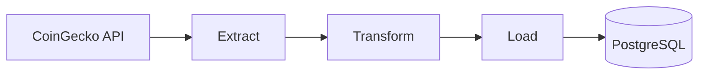

# Pipeline ETL Crypto avec Apache Airflow

**Auteur :** donia-fioklou

## Problématique

Les données de cryptomonnaies évoluent en continu et doivent être collectées, transformées puis historisées automatiquement.  
Comment mettre en place un pipeline robuste qui récupère les principales cryptos, nettoie et enrichit les données, puis les charge dans PostgreSQL à intervalle régulier ?

## Solution : un pipeline ETL automatisé orchestré par Apache Airflow



### Extract : récupérer les données brutes

- **Problème :** les prix et métriques des cryptos changent en permanence.
- **Solution :** interroger l’API CoinGecko pour récupérer les top 20 cryptomonnaies sans authentification.
- Les données extraites incluent notamment :
  - symbole
  - nom
  - prix actuel
  - market cap
  - volume sur 24h
  - variation sur 24h
  - plus haut / plus bas sur 24h

### Transform : nettoyer et enrichir les données

La transformation applique plusieurs règles métier :

| Problème constaté | Technique utilisée |
|---|---|
| Données brutes non homogènes | Nettoyage et normalisation des champs |
| Absence d’indicateur de volatilité | Calcul de la volatilité sur 24h |
| Absence de catégorisation métier | Classification par market cap : Large / Mid / Small Cap |
| Données à historiser | Ajout d’un horodatage d’extraction `extracted_at` |

### Load : historiser dans PostgreSQL

- **Problème :** les données doivent être consultables dans le temps.
- **Solution :** insertion dans la table `crypto_prices` de PostgreSQL.
- Des index sont créés pour améliorer les requêtes sur :
  - `symbol`
  - `extracted_at`

## Architecture technique

- **Apache Airflow 3.1.6** : orchestration du workflow
- **PostgreSQL** : stockage des données
- **Docker Compose** : déploiement de l’environnement
- **Python 3.12** : logique ETL
- **CoinGecko API** : source de données

## Schéma de données

### Table `crypto_prices`

| Colonne | Type | Description |
|---|---|---|
| id | SERIAL | Clé primaire auto-incrémentée |
| symbol | VARCHAR(10) | Symbole crypto (BTC, ETH...) |
| name | VARCHAR(100) | Nom complet |
| current_price | NUMERIC(20,2) | Prix actuel en USD |
| high_24h | NUMERIC(20,2) | Plus haut sur 24h |
| low_24h | NUMERIC(20,2) | Plus bas sur 24h |
| market_cap | BIGINT | Capitalisation boursière |
| market_cap_rank | INT | Rang par market cap |
| volume_24h | BIGINT | Volume échangé sur 24h |
| price_change_24h_pct | NUMERIC(10,4) | Variation du prix sur 24h (%) |
| volatility_24h_pct | NUMERIC(10,2) | Volatilité calculée (%) |
| category | VARCHAR(20) | Large / Mid / Small Cap |
| extracted_at | TIMESTAMP | Date et heure d’extraction |

**Indexes :**
- `idx_crypto_symbol` sur `symbol`
- `idx_crypto_extracted_at` sur `extracted_at`

## Exécution rapide

1. Cloner le projet :
```bash
git clone https://github.com/donia-fioklou/crypto_etl_with_airflow.git
cd crypto_etl_with_airflow
```

2. Démarrer l’environnement :
```bash
docker-compose up -d
```

3. Ouvrir Airflow dans le navigateur :  
`http://localhost:8080`

- Username : `airflow`
- Password : `airflow`

4. Configurer la connexion PostgreSQL dans Airflow :

Dans **Admin → Connections**, créer une connexion :

- **Connection ID** : `crypto_connection`
- **Connection Type** : `Postgres`
- **Host** : `postgres`
- **Schema** : `airflow`
- **Login** : `airflow`
- **Password** : `airflow`
- **Port** : `5432`

5. Activer le DAG `crypto_etl_pipeline` puis lancer une première exécution manuellement.

## Requêtes utiles

### Voir les dernières données chargées

```sql
SELECT symbol, name, current_price, volatility_24h_pct, category, extracted_at
FROM crypto_prices
ORDER BY extracted_at DESC
LIMIT 10;
```

### Voir les cryptos les plus volatiles

```sql
SELECT symbol, name, volatility_24h_pct, current_price
FROM crypto_prices
WHERE extracted_at > NOW() - INTERVAL '1 hour'
ORDER BY volatility_24h_pct DESC
LIMIT 5;
```

### Suivre l’évolution d’une crypto

```sql
SELECT extracted_at, current_price, volatility_24h_pct
FROM crypto_prices
WHERE symbol = 'BTC'
ORDER BY extracted_at DESC
LIMIT 20;
```

## Configuration

### Modifier la fréquence d’exécution

Dans `dags/crypto_etl_dag.py` :

```python
schedule=timedelta(minutes=5),  # Changer ici (ex: hours=1)
```

### Modifier le nombre de cryptos récupérées

Dans la fonction `extract_crypto_data()` :

```python
params = {
    "per_page": 20,  # Changer ici (max 250)
    ...
}
```

## Vérification de la qualité

Quelques points à contrôler après exécution :

- la table `crypto_prices` contient bien des lignes
- les valeurs `symbol` et `name` sont remplies
- les calculs de `volatility_24h_pct` et `category` sont cohérents
- `extracted_at` est correctement renseigné
- la connexion PostgreSQL fonctionne dans Airflow

## Troubleshooting

### Le DAG ne s’exécute pas

- Vérifier que la connexion `crypto_connection` existe
- Consulter les logs Airflow
- Vérifier que les conteneurs Docker sont démarrés

### Erreur API CoinGecko

- Vérifier la connexion internet
- Tenir compte de la limite de requêtes de l’API gratuite

### Erreur PostgreSQL

- Vérifier que le service PostgreSQL est bien démarré
- Tester la connexion dans l’UI Airflow
- Vérifier les identifiants de connexion


